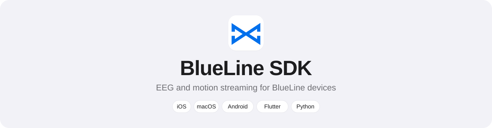

<p align="center">
  <picture>
    <source media="(prefers-color-scheme: dark)" srcset="docs/assets/banner-dark.svg">
    
  </picture>
</p>

<p align="center">
  <a href="https://github.com/enesrsln/BlueLine-SDK/actions/workflows/tests.yml"></a>
  <a href="https://github.com/enesrsln/BlueLine-SDK/releases"></a>
  <a href="LICENSE"></a>
</p>

<p align="center">
  <a href="#quick-start">Quick start</a> ·
  <a href="#how-a-session-works">Sessions</a> ·
  <a href="#data-reference">Data</a> ·
  <a href="#signal-processing">Signal Processing</a> ·
  <a href="#api-across-platforms">API</a> ·
  <a href="docs/PROTOCOL.md">Protocol</a>
</p>

---

The BlueLine SDK streams EEG and accelerometer data from **BlueLine devices**
over Bluetooth Low Energy. Every platform shares one protocol, one data model
and one set of byte-level test vectors, so your app behaves the same
everywhere and recorded data means the same thing on every platform.

- **Multi-channel EEG** at 250 Hz, as raw 24-bit counts or microvolts
- **3-axis accelerometer** at 100 Hz
- **Session and lost-sample tracking**: data is never silently mixed or interpolated
- **Signal processing** built in: filters, power spectrum and EEG band powers, identical on every platform
- Gain control, LED identify, battery and device status

## Supported devices

| Device | EEG channels | EEG rate | Accelerometer | Firmware |
|---|---|---|---|---|
| BlueLine-2 | 2 | 250 Hz | 3-axis, 100 Hz | 0.3.0 and newer |
| BlueLine-4 | 4 | 250 Hz | 3-axis, 100 Hz | 0.3.0 and newer |
| BlueLine-8 | 8 | 250 Hz | 3-axis, 100 Hz | 0.3.0 and newer |

The SDK reads the channel count, rates and features from each device when it
connects. Use `info.channelCount` instead of a fixed number, and your app works
with every BlueLine model.

## Platforms

| Platform | Language | Requirements | Guide |
|---|---|---|---|
| iOS, macOS | Swift | iOS 15+, macOS 12+, Swift 5.9 | [ios](ios/README.md) |
| Android | Kotlin | Android 8.0 (API 26)+ | [android](android/README.md) |
| Flutter | Dart | Flutter 3.22+ · Android, iOS, macOS, Windows, Linux | [flutter](flutter/README.md) |
| Windows, macOS, Linux | Python | Python 3.9+ | [python](python/README.md) |

## Quick start

<details open>
<summary><b>iOS / macOS</b> (Swift)</summary>
<br>

In Xcode, **File › Add Package Dependencies…** and enter
`https://github.com/enesrsln/BlueLine-SDK`. Add
`NSBluetoothAlwaysUsageDescription` to the app's Info.plist.

```swift
import BlueLineSDK

let scanner = BlueLineScanner()
scanner.onBluetoothStateChange = { state in
    if state == .poweredOn { try? scanner.startScan() }
}
scanner.onDeviceFound = { discovery in
    scanner.stopScan()
    Task {
        let device = try await scanner.connect(discovery)
        device.onSignal = { packet in /* packet.microvolts: [[Double]] [sample][channel] */ }
        try await device.startSignal()
    }
}
```

Full guide: [ios/README.md](ios/README.md)
</details>

<details>
<summary><b>Android</b> (Kotlin)</summary>
<br>

Include `android/` as a Gradle build, depend on
`com.blueline.sdk:blueline-android`, and request
`BlueLinePermissions.required()` at runtime.

```kotlin
val scanner = BlueLineScanner(context)
lifecycleScope.launch {
    val device = scanner.connect(scanner.scan().first())
    launch { device.signal.collect { packet -> /* packet.microvolts: Array<DoubleArray> */ } }
    device.startSignal()
}
```

Full guide: [android/README.md](android/README.md)
</details>

<details>
<summary><b>Flutter</b> (Dart)</summary>
<br>

```yaml
dependencies:
  blueline_sdk:
    git:
      url: https://github.com/enesrsln/BlueLine-SDK.git
      path: flutter
      ref: v1.0.0
```

Add the Bluetooth permissions of each platform (listed in the guide), then:

```dart
await BlueLine.requestPermissions();
final device = await BlueLine.connect((await BlueLine.find())!);
device.signal.listen((packet) { /* packet.microvolts: List<List<double>> */ });
await device.startSignal();
```

Full guide: [flutter/README.md](flutter/README.md)
</details>

<details>
<summary><b>Python</b> (Windows, macOS, Linux)</summary>
<br>

```sh
pip install "blueline-sdk @ git+https://github.com/enesrsln/BlueLine-SDK.git@v1.0.0#subdirectory=python"
```

```python
import asyncio, blueline

async def main():
    async with await blueline.connect(await blueline.find()) as device:
        device.on_signal = lambda packet: print(packet.first_index, packet.microvolts[0])
        await device.start_signal()
        await asyncio.sleep(10)

asyncio.run(main())
```

Full guide: [python/README.md](python/README.md)
</details>

## How a session works

<details>
<summary><b>Step by step</b></summary>
<br>

1. **Scan** for the BlueLine service. The scan response carries the model and
   the low 32 bits of the hardware id, so you can tell devices apart before
   connecting.
2. **Connect.** The SDK reads Info (channels, rates, gain, reference voltage,
   features, hardware id), the serial number and firmware revision, and
   enables notifications. When `connect` returns, the device is ready.
3. **Start the signal.** `startSignal()` returns a **session** number. Sample
   indices restart at 0 for every session.
4. **Receive packets.** Each packet holds 5 samples (20 ms) normally, more
   when catching up after radio congestion. Sample `i` of a packet has index
   `firstIndex + i` and time `index / signalRateHz` seconds since the session
   started.
5. **Change gain** if needed. This starts a new session (see above).
6. **Disconnect.** The SDK stops the signal first. Losing the connection also
   stops acquisition on the device.
</details>

<details>
<summary><b>Lost samples</b></summary>
<br>

Every packet has `gapBefore`. It is true when samples before this packet are
missing, for any of these reasons:

- the device could not send them (radio queue full; counted in
  `status.signalSamplesDropped`),
- the sample index did not continue from the previous packet (lost over the
  air),
- the app did not take packets fast enough (Android: more than about 10 s of
  backlog).

Do not interpolate silently over a gap: mark it in the data. The index of the
first sample after the gap is exact, so you can compute how many samples are
missing.
</details>

> [!IMPORTANT]
> **Never mix samples of different sessions.** Changing the gain restarts
> acquisition: a new session starts, sample indices restart at 0 and the
> microvolt scale changes. The SDK delivers only packets of the current session.

## Data reference

<details>
<summary><b>Device information</b> (<code>info</code>)</summary>
<br>

| Field | Example (BlueLine-4) | Meaning |
|---|---|---|
| `channelCount` | 4 | EEG channels |
| `signalRateHz` | 250 | EEG output rate |
| `adcRateHz`, `decimation` | 1000, 4 | each output sample is the mean of `decimation` ADC frames |
| `adcBits` | 24 | ADC resolution |
| `gain` | 6 after boot | amplifier gain; follows `setGain` |
| `vrefMicrovolts` | 2 500 000 | reference used for the microvolt scale |
| `memsRateHz` | 100 | accelerometer rate |
| `features` | signal, MEMS, identify, set gain | capabilities of this firmware |
| `firmwareVersion` | `0.3.6` | |
| `chipID` / `chipIdHex` | 64-bit | stable hardware id |
| `serialNumber` | `BL4-000123` | factory serial, or the hardware id as 16 hex chars if none was written |
</details>

<details>
<summary><b>EEG</b></summary>
<br>

- `samples`: raw signed 24-bit ADC counts, `[sample][channel]`.
- `microvolts`: `count × vref_µV / (gain × 2^23)`.

| Gain | µV per count (vref 2.5 V) | Input range |
|---|---|---|
| 1 | 0.298 | ±2.5 V |
| 2 | 0.149 | ±1.25 V |
| 4 | 0.0745 | ±625 mV |
| 6 (default) | 0.0497 | ±417 mV |
| 8 | 0.0373 | ±313 mV |
| 12 | 0.0248 | ±208 mV |
| 24 | 0.0124 | ±104 mV |
</details>

<details>
<summary><b>Accelerometer</b></summary>
<br>

- `x`, `y`, `z`: raw counts, 3.9 mg per count; `xG`, `yG`, `zG` in g.
- Gravity is included (about 1 g in total at rest).
- `signalIndex`: the EEG sample index when the sample was read, for
  approximate alignment. It is not a hardware-synchronized timestamp, and it is
  empty while the EEG signal is stopped.
</details>

<details>
<summary><b>Status</b></summary>
<br>

`isStreaming`, `batteryPercent`, `gain`, `mtu`, `session`, flags (MEMS on, TX
blocked, EEG sensor fault, accelerometer fault), and per-session counters
`signalSamplesDropped`, `adcFramesLost`, `memsSamplesDropped`. State, flag
and gain changes arrive immediately; counter-only changes at most once per
second.
</details>

## Signal processing

The device delivers raw data. Every SDK includes a processing module with the
same algorithms and the same results on every platform, verified against
SciPy. It has no dependencies and works on live packets and on recorded data.

| Class | What it does | Defaults |
|---|---|---|
| `SignalFilter` | Filters every channel of the stream | 0.5–40 Hz band-pass, 50 Hz notch |
| `SpectrumAnalyzer` | Live power spectrum and delta, theta, alpha, beta and gamma band powers of every channel | 4 s window, 5 updates per second |
| `BlueLineFilter` (`Filter` in Python) | Low-pass, high-pass, band-pass and notch filters for your own chain | 4th-order Butterworth |

> [!TIP]
> Use a 60 Hz notch in the Americas. Allow 1–2 s for the filters to settle
> after `startSignal()` or `setGain()`; the first spectrum arrives once its
> window has filled (4 s).

<details>
<summary><b>Details</b></summary>
<br>

- On-device averaging (`decimation` ADC frames per sample) is **not** an
  anti-alias filter; filter on the host.
- Band powers are absolute (µV²) and relative (share of the total, summing to
  1; optionally normalized by band width). Default bands: delta 1–4 Hz,
  theta 4–8 Hz, alpha 8–13 Hz, beta 13–30 Hz, gamma 30–45 Hz; you can pass
  your own.
- Both classes reset themselves when a new session starts or samples are
  lost, so data from before a gap never mixes with data after it.
- Filters start from the first sample's value, so the electrode offset does
  not ring through the high-pass filter.
- Notch Q is 30 (1.7 Hz wide at 50 Hz). Reference functions: SciPy `butter`,
  `sosfilt`, `iirnotch`, `periodogram`.
</details>

## API across platforms

<details>
<summary><b>Names on each platform</b></summary>
<br>

| Concept | iOS (Swift) | Android (Kotlin) | Flutter (Dart) | Python |
|---|---|---|---|---|
| Scanner | `BlueLineScanner()` | `BlueLineScanner(context)` | `BlueLine` (static) | module functions |
| Bluetooth state | `bluetoothState`, `onBluetoothStateChange` | `bluetoothState: StateFlow<BluetoothState>` | `bluetoothState`, `bluetoothStateChanges` | `BluetoothUnavailable` when scanning |
| Scan | `startScan()`, `onDeviceFound`, `stopScan()` | `scan(): Flow<BlueLineDiscovery>` (scans while collected) | `scan(): Stream` (scans while listened to), `discover()`, `find()` | `discover()`, `find()`, `async with scan()` |
| Connect | `try await scanner.connect(discovery)` | `scanner.connect(discovery)` (suspend), or by MAC address | `await BlueLine.connect(discovery)`, or `connectToId(id)` | `await connect(discovery or address)` |
| Permissions | Info.plist entry | `BlueLinePermissions.required()` / `hasAll()` | `requestPermissions()` + manifest / Info.plist entries | OS Bluetooth permission (macOS) |
| Start / stop EEG | `startSignal()` / `stopSignal()` | `startSignal()` / `stopSignal()` | `startSignal()` / `stopSignal()` | `start_signal()` / `stop_signal()` |
| Start / stop MEMS | `startMEMS()` / `stopMEMS()` | `startMems()` / `stopMems()` | `startMems()` / `stopMems()` | `start_mems()` / `stop_mems()` |
| Gain | `setGain(_:)` | `setGain(gain)` | `setGain(gain)` | `set_gain(gain)` |
| Identify (LED) | `identify()` | `identify()` | `identify()` | `identify()` |
| EEG data | `onSignal` callback | `signal: SharedFlow` | `signal: Stream` | `on_signal`, or `async for p in signal_packets()` |
| MEMS data | `onMEMS` callback | `mems: SharedFlow` | `mems: Stream` | `on_mems` |
| Status, battery | `onStatus`, `onBatteryLevel` | `status`, `batteryLevel: StateFlow` | `statusUpdates`, `batteryLevels: Stream` | `on_status`, `on_battery_level` |
| Connection | `onDisconnect` | `connectionState: StateFlow<ConnectionState>` | `done: Future`, `isConnected` | `on_disconnect`, `is_connected` |
| Disconnect | `await device.disconnect()` | `device.disconnect()` (suspend) or `close()` | `await device.disconnect()` | `await disconnect()`, or leave `async with` |
| Recording | | | | `recording.CsvRecorder` |
| Filters | `SignalFilter`, `BlueLineFilter` | `SignalFilter`, `BlueLineFilter` | `SignalFilter`, `BlueLineFilter` | `SignalFilter`, `Filter` |
| Spectrum, band powers | `SpectrumAnalyzer`, `BlueLineSpectrum` | `SpectrumAnalyzer`, `BlueLineSpectrum` | `SpectrumAnalyzer`, `BlueLineSpectrum` | `SpectrumAnalyzer`, `processing.power_spectrum()` |
| Errors | `BlueLineError` | `BlueLineException` subclasses | `BlueLineException` subclasses | `BlueLineError` subclasses |

Commands run one at a time on every platform; the device rejects a request
that arrives while the previous one is still running.
</details>

<details>
<summary><b>Errors</b></summary>
<br>

| Case | iOS `BlueLineError` | Android `BlueLineException` | Flutter `BlueLineException` | Python `BlueLineError` |
|---|---|---|---|---|
| Bluetooth off, missing or not permitted | `bluetoothUnavailable` | `BluetoothUnavailable` | `BluetoothUnavailable` | `BluetoothUnavailable` |
| Could not connect, GATT error | `connectionFailed` | `ConnectionFailed` (with `gattStatus`) | `ConnectionFailed` | `ConnectionFailed` |
| Unsupported device or firmware | `unsupportedDevice` | `UnsupportedDevice` | `UnsupportedDevice` | `UnsupportedDevice` |
| No answer in time | `timeout` | `Timeout` | `BlueLineTimeout` | `Timeout` |
| Command while disconnected | `notConnected` | `NotConnected` | `NotConnected` | `NotConnected` |
| Link dropped during a request | `disconnected` | `Disconnected` | `Disconnected` | `Disconnected` |
| Bad argument (e.g. gain 5) | `invalidParameter` | `InvalidParameter` | `InvalidParameter` | `InvalidParameter` |
| Device answered with an error | `commandFailed(command, result)` | `CommandFailed(command, result)` | `CommandFailed` (`.result`) | `CommandFailed` (`.result`) |
</details>

## Testing

<details>
<summary><b>Test vectors and commands</b></summary>
<br>

[`testvectors/blueline_protocol_v1.json`](testvectors/blueline_protocol_v1.json)
holds byte strings for every packet type with the values a decoder must
produce, and malformed inputs it must reject.
[`testvectors/blueline_processing_v1.json`](testvectors/blueline_processing_v1.json)
holds filter outputs, spectra and band powers for fixed input signals. Every
SDK runs both in its unit tests:

| SDK | Command |
|---|---|
| iOS / macOS | `swift test` |
| Android | `cd android && ./gradlew -Pblueline.coreOnly=true :blueline-core:test` |
| Flutter | `cd flutter && flutter test` |
| Python | `cd python && python -m unittest discover -s tests -t .` |

To write your own client on another platform, follow
[`docs/PROTOCOL.md`](docs/PROTOCOL.md) and check your decoder against these
vectors.
</details>

<details>
<summary><b>Repository layout</b></summary>
<br>

```
├── Package.swift        Swift Package manifest (sources in ios/)
├── ios/                 iOS / macOS SDK (Swift, CoreBluetooth)
├── android/             Android SDK (Kotlin, coroutines)
│   ├── blueline-core/     pure JVM: protocol, parsers, processing
│   └── blueline-android/  Bluetooth: scanner, device, permissions
├── flutter/             Flutter SDK (Dart)
├── python/              Python SDK (asyncio + bleak)
├── testvectors/         protocol and processing vectors, shared by every SDK
└── docs/PROTOCOL.md     BlueLine BLE protocol, byte by byte
```
</details>

## Versioning

| SDK | Firmware |
|---|---|
| 1.0.0 | 0.3.0 and newer |

The SDK refuses devices with incompatible firmware instead of decoding their
data wrongly. See the [changelog](CHANGELOG.md).

## Roadmap

- **Python**: EDF export.
- **Upcoming support**: BlueLine-tDCS.

## License

The SDK may be used to build applications for BlueLine devices; see
[LICENSE](LICENSE).

> [!NOTE]
> BlueLine devices are not medical devices and must not be used for diagnosis
> or treatment.
