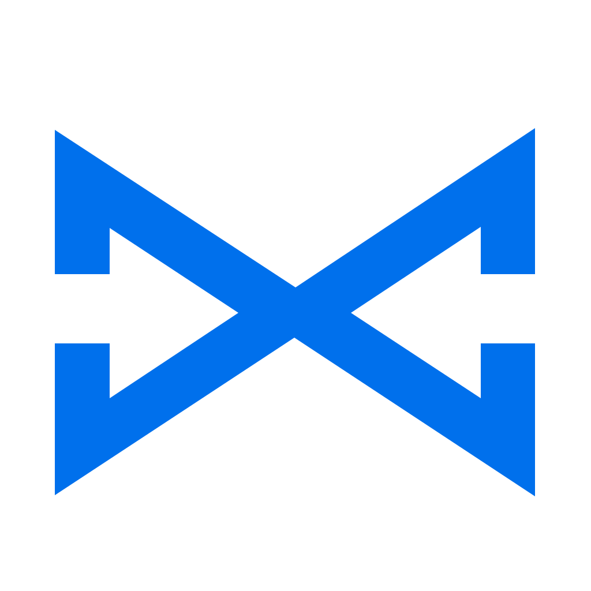

#  BlueLine SDK for Android

Kotlin library for streaming EEG and accelerometer data from **BlueLine**
devices. Same feature set and data model as the iOS SDK (`../ios`).

- Scan, connect, read device info, serial number and firmware
- Multi-channel EEG at 250 Hz, as raw ADC counts or microvolts
- 3-axis accelerometer at 100 Hz, raw counts or g
- Gain control, LED identify, battery and status (loss counters, faults)
- Session and lost-sample handling built in
- Filters, spectrum and band powers (delta–gamma)
- Coroutines API: `suspend` commands, `Flow` data streams

Requirements: Android 8.0 (API 26)+, Kotlin 2.0+, coroutines 1.9+.

## Modules

| Module | Contents |
|---|---|
| `blueline-core` | Pure JVM: protocol UUIDs, packet parsers, `SignalSessionTracker`, signal processing. No Android dependency, usable for recorded data on a desktop JVM. |
| `blueline-android` | Android BLE: `BlueLineScanner`, `BlueLineDevice`, `BlueLinePermissions`. Depends on `blueline-core` (`api`). |

## Installation

Clone this repository (or add it as a Git submodule) and include it as a
source build. In the app's
`settings.gradle.kts`:

```kotlin
includeBuild("path/to/BlueLineSDK/android")
```

and in the app module:

```kotlin
dependencies {
    implementation("com.blueline.sdk:blueline-android:1.0.0")
}
```

The library manifest already declares the Bluetooth permissions
(`BLUETOOTH_SCAN` with `neverForLocation`, `BLUETOOTH_CONNECT`, and
`ACCESS_FINE_LOCATION` up to Android 11). Request them at runtime:

```kotlin
private val permissionLauncher =
    registerForActivityResult(ActivityResultContracts.RequestMultiplePermissions()) { result ->
        if (result.values.all { it }) viewModel.startScan()
    }

if (BlueLinePermissions.hasAll(this)) viewModel.startScan()
else permissionLauncher.launch(BlueLinePermissions.required())
```

## Quick start

```kotlin
class EegViewModel(app: Application) : AndroidViewModel(app) {
    private val scanner = BlueLineScanner(app)
    private var device: BlueLineDevice? = null

    fun startScan() = viewModelScope.launch {
        try {
            val discovery = scanner.scan().first()          // first BlueLine found; scanning stops
            val blueLine = scanner.connect(discovery)
            device = blueLine
            Log.i("EEG", "Connected ${blueLine.name} fw ${blueLine.info.firmwareVersion} serial ${blueLine.serialNumber}")

            val sampleRate = blueLine.info.signalRateHz.toDouble()   // 250
            launch {
                blueLine.signal.collect { packet ->
                    if (packet.gapBefore) Log.w("EEG", "samples lost before index ${packet.firstIndex}")
                    packet.microvolts.forEachIndexed { offset, channels ->
                        val seconds = (packet.firstIndex + offset) / sampleRate
                        // channels: one value per channel, in µV at `seconds` since startSignal
                    }
                }
            }
            launch { blueLine.mems.collect { s -> /* s.xG, s.yG, s.zG */ } }
            launch {
                blueLine.connectionState.collect { state ->
                    if (state is ConnectionState.Disconnected) Log.i("EEG", "Disconnected ${state.error ?: ""}")
                }
            }

            blueLine.startSignal()
            blueLine.startMems()
        } catch (e: BlueLineException) {
            Log.e("EEG", e.message ?: "BlueLine error")
        }
    }

    fun stop() = viewModelScope.launch { device?.disconnect() }   // STOP_SIGNAL, then disconnect

    override fun onCleared() {
        device?.close()
        scanner.close()
    }
}
```

Collect `signal` before calling `startSignal()`: it is a hot flow and packets
sent while nobody collects are not kept.

## API

### `BlueLineScanner(context)`

| Member | Description |
|---|---|
| `bluetoothState: StateFlow<BluetoothState>` | `ON`, `OFF`, `TURNING_ON`, `TURNING_OFF`, `UNSUPPORTED`. |
| `scan(allowDuplicates = false): Flow<BlueLineDiscovery>` | Scans while collected. `BlueLineDiscovery`: `device`, `address`, `name`, `rssi`, `advertisement` (model, `chipIdLow` to tell devices apart before connecting). |
| `connect(discovery, timeoutMillis = 15000)` | Connects, requests MTU 247, high connection priority and 2M PHY, reads Info and device information, enables notifications. Retries GATT error 133 twice. |
| `connect(address, timeoutMillis)` | Same, by saved MAC address. |
| `close()` | Unregisters the Bluetooth state receiver. |

### `BlueLineDevice`

| Member | Description |
|---|---|
| `info: BlueLineInfo` | Channels, `signalRateHz` (250), `memsRateHz` (100), `gain`, `vrefMicrovolts`, `microvoltsPerCount`, `firmwareVersion`, `features`, `chipId`/`chipIdHex`. |
| `serialNumber`, `firmwareRevision`, `mtu`, `session` | |
| `signal: SharedFlow<BlueLineSignalPacket>` | EEG packets of the current session. |
| `mems: SharedFlow<BlueLineMemsSample>` | Accelerometer samples. |
| `status: StateFlow<BlueLineStatus?>`, `batteryLevel: StateFlow<Int?>` | |
| `connectionState: StateFlow<ConnectionState>` | `Connecting`, `Connected`, `Disconnected(error)`. |
| `suspend startSignal(): Int` | Starts EEG; returns the session. Sample indices restart at 0. |
| `suspend stopSignal()`, `startMems()`, `stopMems()` | |
| `suspend setGain(gain): Int` | 1, 2, 4, 6, 8, 12 or 24 (6 after every boot). Restarts acquisition: new session. |
| `suspend identify()` | Blinks the LED green for 2 s. |
| `suspend disconnect()` | Sends STOP_SIGNAL, then disconnects. |
| `close()` | Disconnects immediately, without waiting. |

Commands run one at a time and throw `BlueLineException` subclasses:
`BluetoothUnavailable`, `ConnectionFailed` (with `gattStatus`),
`UnsupportedDevice`, `Timeout`, `NotConnected`, `Disconnected`,
`InvalidParameter`, `CommandFailed` (with `result`).

## Data

Identical to the iOS SDK; see `../ios/README.md` and
`../docs/PROTOCOL.md` for the full description. In short:

- `BlueLineSignalPacket.samples`: raw signed 24-bit counts, `[sample][channel]`;
  `microvolts` uses the session's scale. Sample `i` has index `firstIndex + i`,
  time `index / 250` s since the session start.
- `gapBefore`: samples before this packet were lost on the device, over BLE, or
  because the app fell more than `BlueLineDevice.SIGNAL_BUFFER` packets
  (~10 s) behind. Do not interpolate silently.
- Never mix samples of different sessions: after `setGain` the scale changes.
- Each sample is the mean of 4 ADC frames at 1 kHz, not an anti-alias filter:
  use `SignalFilter` (below) or your own filtering.
- MEMS values include gravity; `signalIndex` aligns approximately with EEG.

## Signal processing

```kotlin
val channels = device.info.channelCount
val filter = SignalFilter(channels)          // 0.5–40 Hz band-pass, 50 Hz notch
val analyzer = SpectrumAnalyzer(channels)    // 4 s window, 5 updates per second

device.signal.collect { packet ->
    val filtered = filter.process(packet)            // [sample][channel] in µV
    for (frame in analyzer.process(packet)) {
        val alpha = frame.channels[0].relative.getValue("alpha")   // share of total, 0–1
    }
}
```

| Class | Description |
|---|---|
| `SignalFilter(channelCount, sampleRate = 250.0, highpass = 0.5, lowpass = 40.0, notch = 50.0, order = 4, filters = null)` | Same chain on every channel; `null` leaves a stage out. `process(packet)`, `filterRows(rows)`, `reset()`. |
| `BlueLineFilter.lowpass / highpass / bandpass / notch` | Single-channel filters: `filter(x)`, `filterArray(values)`, `response(frequency, sampleRate)`. Chain them with `BlueLineFilterList`. |
| `SpectrumAnalyzer(channelCount, sampleRate = 250.0, window = 4.0, updateRate = 5.0, maxFrequency = 50.0, bands = EEG_BANDS, normalizeByBandwidth = false)` | `process(packet): List<SpectrumFrame>`, `addRows(rows)`, `fill`, `reset()`. |
| `SpectrumFrame` | `session`, `endIndex`, `endTime(sampleRate)`, `frequencies`, `channels[c].psd` (µV²/Hz), `.powers` (µV²), `.relative`. |
| `BlueLineSpectrum.powerSpectrum / bandPowers / relativePowers` | The same calculations on one window of recorded data. |

Both classes keep state and reset themselves on a new session or after lost
samples. Use each from one coroutine, off the main thread.

## Android notes

- Notifications are decoded on the Bluetooth callback thread; collect flows on
  any dispatcher. Keep heavy processing off the main thread.
- Some phones need Location services switched on to return BLE scan results
  on Android 11 and lower, even with the permission granted.
- No pairing or bonding: the device rejects pairing requests.

## Tests

```sh
./gradlew :blueline-core:test
```

The core tests run the shared vectors in `../testvectors/` (protocol and
signal processing, the same cases as the other SDKs) and the session/gap
tracking logic. They need only a JDK, no Android SDK or device.
