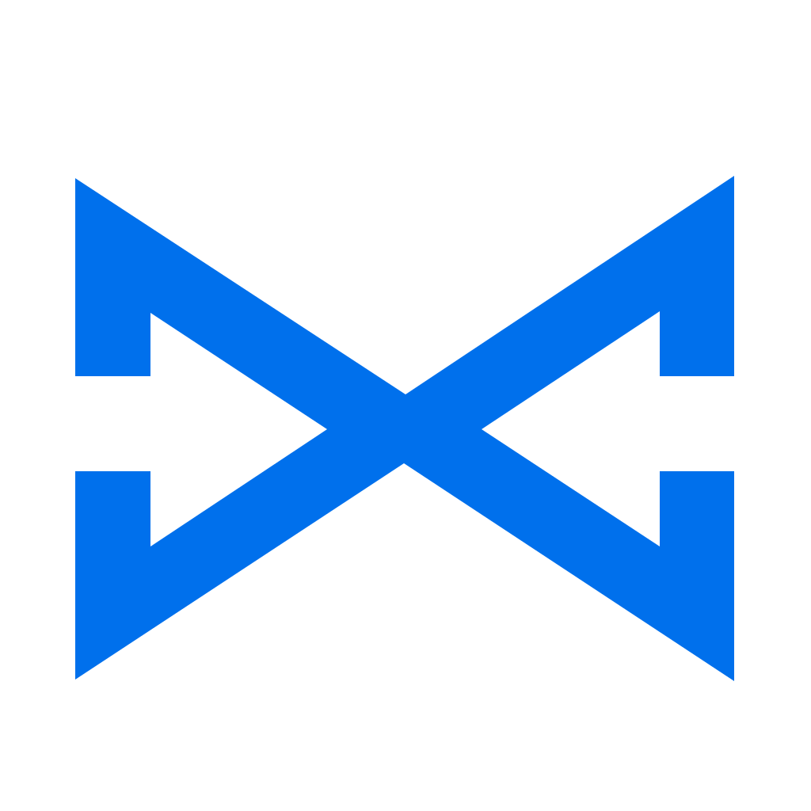

#  BlueLine SDK for Flutter

Dart library for streaming EEG and accelerometer data from **BlueLine**
devices, from one codebase on Android, iOS, macOS, Windows and Linux. Same
feature set and data model as the native SDKs.

- Scan, connect, read device info, serial number and firmware
- Multi-channel EEG at 250 Hz, as raw ADC counts or microvolts
- 3-axis accelerometer at 100 Hz, raw counts or g
- Gain control, LED identify, battery and status (loss counters, faults)
- Session and lost-sample handling built in
- Filters, spectrum and band powers (delta–gamma)
- `Future` commands, `Stream` data

Requirements: Flutter 3.22+ (Dart 3.4+). Android 5.0+ (API 21), iOS 13.1+,
macOS 10.15+, Windows 10+ with a Bluetooth 4.0 adapter, Linux with BlueZ.

Bluetooth goes through [universal_ble](https://pub.dev/packages/universal_ble)
(BSD-3 license, no fees for commercial apps).

## Installation

Depend on it from Git in the app's `pubspec.yaml`:

```yaml
dependencies:
  blueline_sdk:
    git:
      url: https://github.com/enesrsln/BlueLine-SDK.git
      path: flutter
      ref: v1.0.0
```

### Platform setup

**Android** — in `android/app/src/main/AndroidManifest.xml`:

```xml
<uses-permission android:name="android.permission.BLUETOOTH_SCAN"
    android:usesPermissionFlags="neverForLocation" />
<uses-permission android:name="android.permission.BLUETOOTH_CONNECT" />
<uses-permission android:name="android.permission.BLUETOOTH" android:maxSdkVersion="30" />
<uses-permission android:name="android.permission.BLUETOOTH_ADMIN" android:maxSdkVersion="30" />
<uses-permission android:name="android.permission.ACCESS_FINE_LOCATION" android:maxSdkVersion="30" />
<uses-feature android:name="android.hardware.bluetooth_le" android:required="true" />
```

**iOS and macOS** — in `Info.plist`:

```xml
<key>NSBluetoothAlwaysUsageDescription</key>
<string>Connects to your BlueLine EEG headband.</string>
```

On macOS also add `com.apple.security.device.bluetooth` = `true` to
`DebugProfile.entitlements` and `Release.entitlements`.

**Windows, Linux** — nothing to add.

The [example app](example) is set up for all of these.

## Quick start

```dart
import 'package:blueline_sdk/blueline_sdk.dart';

Future<void> run() async {
  await BlueLine.requestPermissions();
  final found = await BlueLine.find();                 // first BlueLine seen, or null after 10 s
  if (found == null) return;

  final device = await BlueLine.connect(found);
  print('${device.name} fw ${device.info.firmwareVersion} serial ${device.serialNumber}');

  final sampleRate = device.info.signalRateHz;         // 250
  device.signal.listen((packet) {
    if (packet.gapBefore) print('samples lost before index ${packet.firstIndex}');
    for (var i = 0; i < packet.sampleCount; i++) {
      final seconds = (packet.firstIndex + i) / sampleRate;
      final channels = packet.microvolts[i];           // one value per channel, in µV
    }
  });
  device.mems.listen((s) => print('${s.xG} ${s.yG} ${s.zG}'));
  device.done.then((error) => print(error == null ? 'disconnected' : 'link lost'));

  await device.startSignal();
  await device.startMems();
  await Future<void>.delayed(const Duration(seconds: 30));
  await device.disconnect();                           // STOP_SIGNAL, then disconnect
}
```

Listen to `signal` before calling `startSignal()`: the streams are broadcast
streams and do not keep packets sent while nobody listens.

## API

### `BlueLine`

| Member | Description |
|---|---|
| `requestPermissions()` | Bluetooth permissions (Android 12+: scan and connect; iOS: the system prompt). |
| `bluetoothState`, `bluetoothStateChanges` | `poweredOn`, `poweredOff`, `unauthorized`, `unsupported`, `unknown`. |
| `scan({timeout, allowDuplicates = false}): Stream<BlueLineDiscovery>` | Scans while listened to; cancel the subscription to stop. `BlueLineDiscovery`: `id`, `name`, `rssi`, `advertisement` (model, `chipIdLow` to tell devices apart before connecting). |
| `discover({timeout = 5 s})` | Every BlueLine found, strongest signal first. |
| `find({id, timeout = 10 s})` | The first BlueLine seen, or the one with `id`; null after the timeout. |
| `connect(discovery, {timeout = 20 s})` | Connects, requests MTU 247 and high connection priority (Android), reads Info and device information, enables notifications. |
| `connectToId(id, {name, timeout})` | Same, by a saved id: MAC address on Android, Windows and Linux; a per-phone UUID on iOS and macOS. |

### `BlueLineDevice`

| Member | Description |
|---|---|
| `info: BlueLineInfo` | Channels, `signalRateHz` (250), `memsRateHz` (100), `gain`, `vrefMicrovolts`, `microvoltsPerCount`, `firmwareVersion`, `features`, `chipIdHex`. |
| `serialNumber`, `firmwareRevision`, `batteryLevel`, `status`, `mtu`, `session`, `isConnected` | |
| `signal: Stream<BlueLineSignalPacket>` | EEG packets of the current session. |
| `mems: Stream<BlueLineMemsSample>` | Accelerometer samples. |
| `statusUpdates: Stream<BlueLineStatus>`, `batteryLevels: Stream<int>` | |
| `done: Future<BlueLineException?>` | Completes with null after `disconnect()`, or with `Disconnected` when the link was lost. The streams close at the same time. |
| `startSignal(): Future<int>` | Starts EEG; returns the session. Sample indices restart at 0. |
| `stopSignal()`, `startMems()`, `stopMems()` | |
| `setGain(gain): Future<int>` | 1, 2, 4, 6, 8, 12 or 24 (6 after every boot). Restarts acquisition: new session. |
| `identify()` | Blinks the LED green for 2 s. |
| `disconnect()` | Sends STOP_SIGNAL, then disconnects. |

Commands run one at a time (calls made together are queued in order) and
throw `BlueLineException` subclasses: `BluetoothUnavailable`,
`ConnectionFailed`, `UnsupportedDevice`, `BlueLineTimeout`, `NotConnected`,
`Disconnected`, `InvalidParameter`, `CommandFailed` (with `result`).

## Data

Identical to the other SDKs; see `../README.md` and `../docs/PROTOCOL.md`.
In short:

- `BlueLineSignalPacket.samples`: raw signed 24-bit counts, `[sample][channel]`;
  `microvolts` uses the session's scale. Sample `i` has index `firstIndex + i`,
  time `index / 250` s since the session start.
- `gapBefore`: samples before this packet were lost on the device or over
  BLE. Do not interpolate silently.
- Never mix samples of different sessions: after `setGain` the scale changes.
- Each sample is the mean of 4 ADC frames at 1 kHz, not an anti-alias filter:
  use `SignalFilter` (below) or your own filtering.
- MEMS values include gravity; `signalIndex` aligns approximately with EEG.

## Signal processing

```dart
final channels = device.info.channelCount;
final filter = SignalFilter(channels);               // 0.5–40 Hz band-pass, 50 Hz notch
final analyzer = SpectrumAnalyzer(channels);         // 4 s window, 5 updates per second

device.signal.listen((packet) {
  final filtered = filter.process(packet);            // [sample][channel] in µV
  for (final frame in analyzer.process(packet)) {
    final alpha = frame.channels[0].relative['alpha']!;   // share of total, 0–1
  }
});
```

| Class | Description |
|---|---|
| `SignalFilter(channelCount, {sampleRate = 250, highpass = 0.5, lowpass = 40, notch = 50, order = 4, filters})` | Same chain on every channel; `null` leaves a stage out. `process(packet)`, `filterRows(rows)`, `reset()`. |
| `BlueLineFilter.lowpass / highpass / bandpass / notch` | Single-channel filters: `filter(x)`, `filterAll(values)`, `response(frequency, sampleRate)`. Chain them with `BlueLineFilterList`. |
| `SpectrumAnalyzer(channelCount, {sampleRate = 250, window = 4, updateRate = 5, maxFrequency = 50, bands = EegBand.defaults, normalizeByBandwidth = false})` | `process(packet): List<SpectrumFrame>`, `addRows(rows)`, `fill`, `reset()`. |
| `SpectrumFrame` | `session`, `endIndex`, `endTime(sampleRate)`, `frequencies`, `channels[c].psd` (µV²/Hz), `.powers` (µV²), `.relative`. |
| `BlueLineSpectrum.powerSpectrum / bandPowers / relativePowers` | The same calculations on one window of recorded data. |

Both classes keep state and reset themselves on a new session or after lost
samples. They are light enough to run on the UI isolate at 250 Hz.

For recorded data without Flutter (a Dart server or command-line tool),
import `package:blueline_sdk/blueline_core.dart`: protocol parsers, session
tracking and processing, with no Flutter or Bluetooth dependency.

## Other Bluetooth stacks

`BlueLineDevice` talks to Bluetooth through the `BlueLineTransport`
interface (connect, read, write, subscribe). `BlueLine.connect` uses
`UniversalBleTransport`. If your app already uses another BLE package,
implement `BlueLineTransport` on top of it and connect with
`BlueLineDevice.connectWith(transport, id: ...)`. The unit tests use the
same interface with a simulated device.

## Platform notes

- No pairing or bonding: the device rejects pairing requests.
- Android 11 and lower: some phones return BLE scan results only with
  Location services switched on.
- iOS and macOS report a UUID instead of the MAC address; it is stable for
  one phone, but differs between phones.
- Web is not supported yet.

## Example

[`example/`](example) scans, connects, and shows the sample rate, filtered
values and live band powers per channel, with start/stop, gain and identify.

```sh
cd example
flutter run
```

## Tests

```sh
flutter test
```

The tests run the shared vectors in `../testvectors/` (protocol and signal
processing, the same cases as the other SDKs), the session/gap tracking, and
`BlueLineDevice` against a simulated device (commands, busy and timeout
handling, gain sessions, link loss). They need no device or phone.
