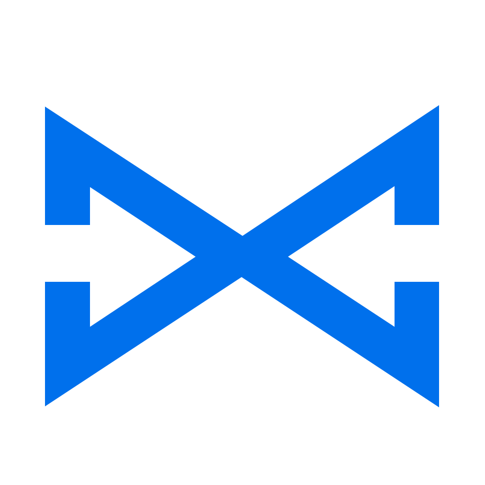

#  BlueLine SDK for iOS

Swift package for streaming EEG and accelerometer data from **BlueLine**
devices.

- Scan, connect, read device info, serial number and firmware
- Multi-channel EEG at 250 Hz, as raw ADC counts or microvolts
- 3-axis accelerometer at 100 Hz, raw counts or g
- Gain control, LED identify, battery and status (loss counters, faults)
- Session and lost-sample handling built in
- Filters, spectrum and band powers (delta–gamma)

Requirements: iOS 15+ (macOS 12+ also builds), Swift 5.9+, Xcode 15+.

## Installation

Swift Package Manager. In Xcode: **File > Add Package Dependencies…** and
enter `https://github.com/enesrsln/BlueLine-SDK`, or in `Package.swift`:

```swift
.package(url: "https://github.com/enesrsln/BlueLine-SDK.git", from: "1.0.0")
// target: .product(name: "BlueLineSDK", package: "BlueLine-SDK")
```

Add a Bluetooth usage description to your app's Info.plist:

```xml
<key>NSBluetoothAlwaysUsageDescription</key>
<string>Connects to your BlueLine device to record EEG.</string>
```

## Quick start

```swift
import BlueLineSDK

let scanner = BlueLineScanner()          // callbacks arrive on the main queue
var device: BlueLineDevice?

scanner.onBluetoothStateChange = { state in
    guard state == .poweredOn else { return }
    try? scanner.startScan()
}

scanner.onDeviceFound = { discovery in
    scanner.stopScan()
    Task {
        do {
            let blueLine = try await scanner.connect(discovery)
            device = blueLine
            print("Connected:", blueLine.name, "fw", blueLine.info.firmwareVersion,
                  "serial", blueLine.serialNumber ?? "-")

            let sampleRate = Double(blueLine.info.signalRateHz)   // 250
            blueLine.onSignal = { packet in              // don't capture the device: avoids a retain cycle
                if packet.gapBefore { print("samples lost before index", packet.firstIndex) }
                for (offset, channels) in packet.microvolts.enumerated() {
                    let index = packet.firstIndex + UInt32(offset)
                    let seconds = Double(index) / sampleRate
                    // channels: one value per channel, in µV at `seconds` since startSignal
                }
            }
            blueLine.onMEMS = { sample in
                // sample.xG, sample.yG, sample.zG (gravity included)
            }
            blueLine.onDisconnect = { error in print("Disconnected", error ?? "") }

            try await blueLine.startSignal()
            try await blueLine.startMEMS()
        } catch {
            print("BlueLine error:", error.localizedDescription)
        }
    }
}

// Later:
// await device?.disconnect()   // sends STOP_SIGNAL, then disconnects
```

Keep the `BlueLineScanner` alive (for example as a property of a long-lived
object) while you use its devices.

## API

### `BlueLineScanner`

| Member | Description |
|---|---|
| `init(queue: DispatchQueue = .main)` | All Bluetooth work and callbacks run on `queue`. |
| `bluetoothState`, `onBluetoothStateChange` | Scanning and connecting need `.poweredOn`. |
| `startScan(allowDuplicates:)`, `stopScan()` | Scans for the BlueLine service. |
| `onDeviceFound: (BlueLineDiscovery) -> Void` | `name`, `rssi`, `identifier`, `advertisement` (model, `chipIDLow` to tell devices apart before connecting). |
| `connect(_:timeout:) async throws -> BlueLineDevice` | Connects, reads Info and device information, enables notifications. |
| `disconnect(_:) async` | Same as `device.disconnect()`. |

### `BlueLineDevice`

| Member | Description |
|---|---|
| `info: BlueLineInfo` | Channels, `signalRateHz` (250), `memsRateHz` (100), `gain`, `vrefMicrovolts`, `microvoltsPerCount`, `firmwareVersion`, `features`, `chipID`. |
| `serialNumber`, `firmwareRevision`, `batteryLevel`, `status` | From the device information, battery and status characteristics. |
| `startSignal() async throws -> UInt16` | Starts EEG; returns the session. Sample indices restart at 0. |
| `stopSignal() async throws` | |
| `startMEMS()`, `stopMEMS()` | Accelerometer stream. |
| `setGain(_:) async throws -> UInt16` | 1, 2, 4, 6, 8, 12 or 24 (6 after every boot). Restarts acquisition: new session. |
| `identify() async throws` | Blinks the LED green for 2 s. |
| `disconnect() async` | Stops acquisition and disconnects. |
| `onSignal`, `onMEMS`, `onStatus`, `onBatteryLevel`, `onDisconnect` | Data and state callbacks. |

Commands may be called from any thread; they run one at a time (the
firmware rejects overlapping requests). Failures throw `BlueLineError`.

## Data

### EEG (`BlueLineSignalPacket`)

- `samples`: raw signed 24-bit ADC counts, `[sample][channel]`.
- `microvolts`: `count × vref_µV / (gain × 2^23)`, using the scale of the
  packet's session (`microvoltsPerCount`).
- `firstIndex`: index of the first sample since `startSignal()`. Sample `i`
  has index `firstIndex + i` and time `index / 250` s from the session start.
- Packets normally hold 5 samples (20 ms); up to 19 while catching up.
- `gapBefore`: samples before this packet were lost (on the device or over
  BLE). Do not interpolate silently; mark the gap in your analysis.
- `session`: only packets of the current session are delivered. **Never mix
  samples of different sessions**: after `setGain(_:)` the scale changes.
- Each output sample is the mean of 4 ADC frames at 1 kHz. That is not an
  anti-alias filter: use `SignalFilter` (below) or your own filtering.

### Accelerometer (`BlueLineMEMSSample`)

- `x`, `y`, `z`: raw accelerometer counts, 3.9 mg per count; `xG`, `yG`, `zG` in g.
- Values include gravity (about 1 g in total at rest).
- `signalIndex`: EEG sample index when the sample was read, for approximate
  alignment with EEG. It is not a hardware-synchronized timestamp.

### Status (`BlueLineStatus`)

`isStreaming`, `batteryPercent`, `gain`, `mtu`, `session`, fault and
`txBlocked` flags, and per-session counters `signalSamplesDropped` (BLE queue
full) and `adcFramesLost`. Changes notify immediately; counter-only changes at
most once per second.

## Signal processing

```swift
let channels = device.info.channelCount
let filter = try SignalFilter(channelCount: channels)        // 0.5–40 Hz band-pass, 50 Hz notch
let analyzer = try SpectrumAnalyzer(channelCount: channels)  // 4 s window, 5 updates per second

blueLine.onSignal = { packet in
    let filtered = filter.process(packet)             // [sample][channel] in µV
    for frame in analyzer.process(packet) {
        let alpha = frame.channels[0].relative["alpha"] ?? 0   // share of total, 0–1
    }
}
```

| Type | Description |
|---|---|
| `SignalFilter(channelCount:sampleRate:highpass:lowpass:notch:order:filters:)` | Same chain on every channel; `nil` leaves a stage out. `process(_:)`, `filter(rows:)`, `reset()`. Defaults 250 Hz, 0.5, 40, 50, order 4. |
| `BlueLineFilter.lowpass / highpass / bandpass / notch` | Single-channel filters: `filter(_:)`, `response(frequency:sampleRate:)`. Chain them with `BlueLineFilterList`. |
| `SpectrumAnalyzer(channelCount:sampleRate:window:updateRate:maxFrequency:bands:normalizeByBandwidth:)` | `process(_:) -> [SpectrumFrame]`, `add(rows:)`, `fill`, `reset()`. Defaults 250 Hz, 4 s, 5 per second, 50 Hz. |
| `SpectrumFrame` | `session`, `endIndex`, `endTime(sampleRate:)`, `frequencies`, `channels[c].psd` (µV²/Hz), `.powers` (µV²), `.relative`. |
| `BlueLineSpectrum.powerSpectrum / bandPowers / relativePowers` | The same calculations on one window of recorded data. |
| `EEGBand.defaults` | delta 1–4, theta 4–8, alpha 8–13, beta 13–30, gamma 30–45 Hz. |

Invalid parameters (for example a cutoff above Nyquist) throw
`BlueLineError.invalidParameter`. Both classes keep state and reset themselves
on a new session or after lost samples; use each from one queue, the queue
`onSignal` is called on.

## Tests

From the BlueLineSDK root folder (where `Package.swift` is):

```sh
swift test
```

The tests cover all packet parsers with byte-level fixtures, and signal
processing with the shared vectors in `testvectors/blueline_processing_v1.json`.
If the package
lives in an iCloud-synced folder (such as Desktop) and test signing fails with
"resource fork, Finder information, or similar detritus not allowed", build
elsewhere: `swift test --scratch-path /tmp/BlueLineSDK-build`.
